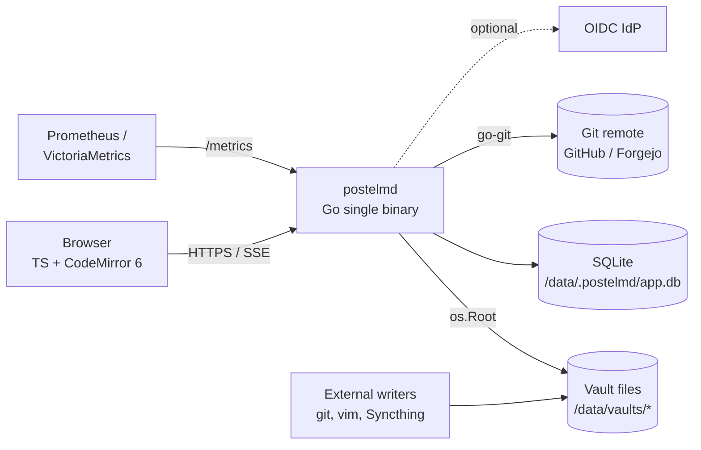

# PostelMD: Architecture

- **Status:** Draft v0.2 (revised after design review)
- **Last updated:** 2026-11-09

Decisions are recorded in [`adr/`](adr/). This document describes how the pieces fit together.

## 1. System context



There is **one process** and **one writer**, enforced by the instance lock (ADR-0014). The
browser never touches files directly. External writers are supported with a bounded guarantee
(ADR-0003 §1).

## 2. Components

### Backend (Go, `internal/`)

**Boundary rule:** only packages under `internal/store/...` perform filesystem or SQLite I/O.
Everything else consumes their interfaces.

| Package | Responsibility |
|---|---|
| `http` | Routing (stdlib `ServeMux`), middleware (auth, CSRF, CSP, request ID, rate limit), JSON + SSE handlers. No business logic. |
| `service` | Use cases (save, move, search, commit, backup) and authorization checks via memberships |
| `store/fs` | Vault access via `os.Root`, reserved-path enforcement (ADR-0006), atomic writes, the re-`stat` check |
| `store/watch` | fsnotify adapter. Emits raw hints; it is the only place that touches inotify. |
| `store/git` | go-git adapter. go-git touches only `.git/`; commits are built from supplied bytes and worktree changes go through `store/fs` (ADR-0016 spike results) |
| `store/sql` | SQLite repositories (sqlc), migrations, outbox, intent log |
| `store/lock` | Instance lock (`flock`), vault and file locks with fixed lock ordering |
| `store/auditfile` | The `file:` audit sink: an append-only JSON-lines file on a separate volume (§9). Filesystem I/O, so it lives under `store`. |
| `vault` | Vault lifecycle and states, including maintenance mode |
| `sync` | Debouncing of watcher hints, the reconciler, the per-vault event bus, SSE fan-out with replay and per-event authorization |
| `gitvault` | The git state machine (ADR-0016): auto-commit batching, pull/push policy, crash repair |
| `secrets` | gitleaks rules: synchronous save scan, commit gate, outgoing-range scan, findings |
| `index` | FTS5 and link extraction (goldmark). Jobs carry `(fileID, generation)`. |
| `auth` | Providers (`local`, `oidc`, `trusted-header`), sessions, the account lifecycle (ADR-0018) |
| `keys` | Key ring: purposes, versions, rotation, envelope encryption (ADR-0005) |
| `setup` | First-run lock and setup token |
| `audit` | The only way to record a security-relevant action (CLAUDE.md rule 15): writes the event to the DB (through `store/sql`) **and** to the external sink: `stdout` via `slog`, `file:` via `store/auditfile`, `webhook` via `egress`. Never receives note content or secret values. |
| `egress` | The single outbound HTTP client (§11, CLAUDE.md rule 13): IP policy with pinned DNS, approved exceptions per purpose, re-checked redirects, timeouts and size caps. Installed as go-git's `http`/`https` transport (#40). Network I/O only, so it isn't under `store`. |
| `plugins` | Manifests, signature and integrity checks, approvals bound to capabilities, revocation list |
| `config` | Flags > env (`_FILE`) > `config.yaml` > defaults. **The single documented exception to the boundary rule:** it reads `config.yaml` and `_FILE` secrets during bootstrap, before the store exists. |

### Frontend (TypeScript, `web/`)

| Module | Responsibility |
|---|---|
| `core/docStore` | Open documents: file ID, ETag, edit generation, dirty state. The single source of client truth. |
| `core/saveQueue` | Immutable snapshots, debounce, `If-Match`, edit-generation check on response, backoff, conflict hand-off; never creates files |
| `core/drafts` | IndexedDB drafts keyed `instanceID/userID/vaultID/fileID/esid` (per editing session, claimed with Web Locks); logout and retention rules (ADR-0018) |
| `core/syncEngine` | SSE client, `Last-Event-ID` + boot epoch, applies events, never overwrites dirty buffers, full resync on gap |
| `core/treeStore` | File tree state, optimistic updates reconciled with the server |
| `core/pluginHost` | Trusted plugin loader; one sandboxed iframe per plugin; capability-checked RPC |
| `editor/` | CodeMirror 6: markdown, language data, keymaps, secret-paste warning extension |
| `preview/` | markdown-it in a Web Worker → blocks → DOMPurify on the main thread (inside the only Trusted Types policy) → patch only changed blocks (ADR-0007). Mermaid via a first-party bundled plugin (from v0.4; core before that). |
| `ui/` | Shell (Lit custom elements in the light DOM; the editor host mounts CodeMirror in a shadow root, ADR-0019): tree, tabs, dialogs, command palette, conflict view, git status |

`core/` has **no UI-framework imports** and is unit-tested with Vitest.

## 3. Data layout (`/data` volume)

```
/data/
  vaults/
    <vault-slug>/            # a git working tree; .md files are the source of truth
      _assets/               # pasted or uploaded media
      .git/                  # reserved (ADR-0006)
      .postelmd-trash/       # reserved; deletes are atomic moves here, purged after 7 days (ADR-0003)
      .postelmd-tmp/         # reserved; temp files of in-flight writes, named by their intents
  .postelmd/                 # app state; never inside a vault; reserved
    instance.lock            # flock held by the single running process (ADR-0014)
    admin.sock               # 0600 Unix socket for online CLI commands (ADR-0009)
    app.db                   # SQLite WAL: identity, ACLs, file IDs, findings, outbox, intent log, FTS
    keys/                    # key ring, one key per purpose, versioned, 0600 (ADR-0005)
    recovery/                # overwritten or stashed content kept 7 days (ADR-0003, ADR-0016)
    plugins/<id>/<version>/  # approved plugin artifacts, hash-pinned
    templates/               # instance templates (starter pack copied on first run)
    pre-migrate-*.db         # automatic snapshots before schema migrations (ADR-0015)
```

Existing notes are mounted at `/data/vaults/<name>`, never at the root of `/data` (ADR-0009).
SQLite and the instance lock refuse network filesystems unless explicitly overridden.

## 4. Save protocol (ADR-0003)

```mermaid
sequenceDiagram
  participant E as Editor (saveQueue)
  participant S as Server
  participant FS as Vault FS
  E->>S: PUT /api/v1/vaults/{v}/files/{id}<br/>If-Match: "id.gen.hash"  (snapshot editGen=7)
  S->>S: lock(vault→file), check ID + generation + hash
  alt matches
    S->>S: commit the save intent (synchronous=FULL)
    S->>FS: write .postelmd-tmp/<op>, fsync, re-stat target, rename, fsync both dirs
    S->>S: synchronous secret scan
    S->>S: TX: generation+1, hash, findings, outbox row, clear intent
    S-->>E: 200 ETag "id.gen+1.hash'" + findings
    S->>S: publish event from outbox (watcher echo suppressed)<br/>queue index + commit with (id, gen)
    E->>E: clear dirty only if editGen still 7
  else mismatch, but current content = submitted content
    S-->>E: 200 + current ETag (idempotent retry; nothing written)
  else mismatch
    S-->>E: 412 + current content and ETag → conflict view
  else tombstone
    S-->>E: 410 (never recreated)
  end
```

Create uses `If-None-Match: *`. Move and rename are **no-clobber**. Folder operations take a
subtree lock. Limits, tests and the client contract are in ADR-0003.

## 5. Change propagation (ADR-0004, ADR-0018)

```
store/watch (hint) ─┐
reconciler (truth: startup + every 5 min; mtime/size/hash; external-rename pairing) ─┼─> per-vault bus ─> SSE /api/v1/events
outbox (app writes, published explicitly) ─┘                 (boot epoch + monotonic id; replay re-authorized)
```

- Events: `file.created|updated|deleted|moved`, `tree.changed`, `git.status`,
  `findings.changed`, `access.revoked`, `resync`.
- Each SSE stream is bound to a session. Every event is authorized when it is delivered.
  Revocation closes the stream.
- A slow consumer whose buffer exceeds 1,000 events or 1 MB is disconnected with `resync`.
- **Snapshot-to-stream handoff:**
  1. The client **opens the event stream first** and records the first cursor C0 it receives
     (or the server returns the head cursor in the stream's `hello` event).
  2. It loads the snapshot (tree + documents, each item carrying its file ID and generation).
  3. It applies buffered and replayed events after C0, **deduplicating by generation**: an
     event is applied only if its `(fileID, generation)` is newer than what the snapshot
     showed.

  Because the cursor is captured *before* the reads, no update can fall between them. A
  snapshot that is newer than some events just causes those events to be skipped.
- The response sets `X-Accel-Buffering: no` and sends a heartbeat every 15 s.

## 6. API shape

- JSON API under `/api/v1/...`. The UI is served from `/` (embedded SPA). There is **no content
  negotiation on the same URL**.
- RESTful resources: `vaults`, `vaults/{v}/files/{id}`, `vaults/{v}/folders`, `search`,
  `vaults/{v}/git/*`, `vaults/{v}/findings`, `templates`, `plugins`, `users`, `invites`,
  `sessions`, `setup`.
- The OpenAPI spec at `api/openapi.yaml` is the contract. TS types are generated from it.

## 7. Plugins (ADR-0008)

| Tier | Runs in | Can do | Installed by |
|---|---|---|---|
| Trusted | Main window (same-origin ES module, integrity-pinned) | `TrustedApp`: CM6 extensions, commands, DOM views | Instance admin only |
| Sandboxed | One opaque-origin iframe **per plugin**, with its Workers created inside it, and a per-plugin CSP | `SandboxApp` (serializable) over capability-checked RPC; **headless** by default (Worker + host-rendered UI), DOM UI only with admin approval if it reads data | Any user, for themselves (if allowed) |

First-party bundled plugins are on by default. Third-party plugins are never preinstalled.
Safe mode and emergency disable are always available.

## 8. Deployment and lifecycle

| Path | Notes |
|---|---|
| `docker run` | One container + one volume (`--user` for bind mounts). Setup token in the logs. |
| Compose | Example file; same image |
| Helm (OCI) | StatefulSet `replicas: 1`, **ReadWriteOncePod** PVC, `existingSecret`, ServiceMonitor, Ingress or Gateway, NetworkPolicy |
| Binary | GoReleaser, `--data-dir` |

**Probes:**
- `/healthz` (liveness, no dependencies);
- `/readyz` (index loaded and initial reconcile done; stays ready in vault read-only mode);
- `startupProbe` covers the first indexing.

**Shutdown sequence**, with a hard deadline of 45 s and `terminationGracePeriodSeconds: 60`:
1. Stop accepting new requests; mark not-ready (0 s).
2. Send `resync` to SSE clients and close the streams.
3. Let in-flight saves finish (≤ 10 s each; they are already bounded).
4. Let a running git operation finish, or stop at a safe point (≤ 20 s). Otherwise its intent
   record makes startup repair it.
5. Stop the index and commit workers. **Queued work is not flushed**: it is durable in the
   outbox and resumes on start.
6. Checkpoint the SQLite WAL, release the instance lock, exit.

**Resource bounds:**
- per-vault work bounded **per kind** (ADR-0003 §6): index jobs collapse into a reindex,
  commit obligations are never dropped (they collapse into a commit-scan), notification
  overflow sends `resync`, and intents are never coalesced;
- SSE buffers as in §5;
- upload and note limits (ADR-0009);
- on `ENOSPC`/`EROFS` the vault switches to read-only, saves return `507`, an alert fires, and
  the client keeps its drafts.

**Homelab** (the maintainer, as "just another user"): an Argo CD Application in the `homelab`
repo; Longhorn RWOP PVC; Sealed Secrets; Harbor pull-through cache; VictoriaMetrics; access via
Tailscale. RTO/RPO are in ADR-0014 §5; backup and restore in ADR-0017.

## 9. Observability and audit

| Signal | Examples |
|---|---|
| Metrics | `postelmd_save_total{result}`, `postelmd_save_conflicts_total`, `postelmd_external_overwrite_suspected_total`, `postelmd_outbox_pending`, `postelmd_watcher_lag_seconds`, `postelmd_reconcile_drift_total`, `postelmd_secret_findings_open`, `postelmd_git_push_total{result}`, `postelmd_split_brain_total` |
| Logs | slog JSON with request IDs. Never log note content, secret values or tokens. |
| Alerts (suggested) | Save errors > 0, split brain > 0, reconcile drift spikes, git push failures, disk > 80%, outbox backlog |

**Audit log** (an append-only SQLite table, admin-readable in the UI and exportable as JSON):
- **Covers:** logins and failures, session revocations, account state changes, membership and
  role changes, ownership transfers, finding acknowledgements and allow-list changes, plugin
  approvals, disables and revocations, key rotations, backups and restores, vault maintenance
  mode, and external changes detected by the reconciler (attributed as "external").
- **External audit sink.** The in-database log is lost with the instance or rolled back by a
  restore, so every audit event is also sent to an external sink (`POSTELMD_AUDIT_SINK`):
  - `stdout` (default): structured `audit` log lines. **This is only a transport**; how long
    they are kept depends on the operator's log pipeline;
  - `file:<path>`: an append-only JSON-lines file **on a separate volume** (not `/data`);
  - `webhook` (post-MVP): signed, through the egress client.

  The rule, which the docs and the restore UI enforce: **the external sink's retention must be
  at least the age of the oldest backup you might restore** (with the defaults in ADR-0014,
  ≥ 8 weeks; 90 days recommended). If the restore can't confirm coverage since the backup
  timestamp, quarantine falls back to per-account approval (ADR-0017). Without a log
  store, use the `file:` sink on a separate volume.
- **Retention:** 365 days by default. Entries reference user IDs, and survive user deletion
  with the state marked.
- Content edits are attributed through git history (ADR-0016), not duplicated in the audit log.

## 10. CI/CD and supply chain (ADR-0015)

- The public repo uses **GitHub-hosted runners only**. Fork PRs never run on self-hosted ARC
  runners.
- Gates per milestone (see the roadmap). Candidates are promoted to releases. Verification
  identities are pinned.
- Renovate; `govulncheck`; `npm ci --ignore-scripts`; Trivy; Syft SBOM; cosign.

## 11. Outbound network (egress) policy

Every server-side outbound connection (git remotes, OIDC discovery, plugin registry and
revocation fetches, Grafana/Prometheus proxying, future webhooks) goes through one egress
client:
- **Default deny for private, loopback, link-local and metadata ranges** (RFC 1918, RFC 4193,
  127/8, 169.254/16 including cloud metadata, ::1). DNS is resolved once and the connection is
  pinned to the checked IP (prevents DNS-rebinding).
- **Narrow exceptions:** the admin approves exact `scheme://host:port` entries per purpose (for
  example, `grafana embed: https://grafana.home.lan:443`). Private targets are then allowed
  **only** for that purpose and that host. There are no CIDR-wide allow rules in the UI.
- **Redirects:** at most 3. Each hop is re-checked against the policy. Credentials are
  never forwarded to a different host than the one they were configured for.
- **Git remotes:** HTTPS or SSH to approved hosts (public hosts are allowed by default; private
  hosts need an exception). Credentials are bound to the remote URL.
- Timeouts and response size caps apply per purpose.
